<a href="https://linkedin.com/in/talhamubeen"></a>

  

  
  
  
  

I'm the Lead Technical Architect of **Panovia** at Attimo, an AI-native platform for project management and execution. Before that I was a Fullstack AI Engineer (Python) at **OpenAI**, building tools for model training, inference and deployment. Earlier, I built rail-safety devices that warn track workers about approaching trains. I like problems where a wrong answer costs something.



<b>How Panovia keeps AI honest</b>

 

- **Judges earn trust.** An LLM judge is used only after it agrees with human reviewers at Cohen's κ ≥ 0.6, with release gates, monthly re-verification and shadow-replay tests.
- **Four levels of human oversight:** automatic, confirm, approval, prohibited. Tenants can only tighten the gates, never loosen them.
- **Every AI value is labelled by its source**, and every change is versioned and audited.
- **A bounded agent runtime** (propose, critique, fill gaps) admits a learned skill only when it shows a measured gain.
- **Zero-retention gate** for AI providers as part of the KVKK / GDPR programme.

### Selected work

<table>
<tr>
<td width="50%"><a href="https://talhamubeen.github.io/dev-manager/"></a></td>
<td width="50%"><a href="https://github.com/TalhaMubeen/ai-context-compressor"></a></td>
</tr>
<tr>
<td><a href="https://github.com/TalhaMubeen/Document-Ingestion"></a></td>
<td><a href="https://github.com/TalhaMubeen/Gatearm-Light-Monitoring"></a></td>
</tr>
<tr>
<td><a href="https://github.com/TalhaMubeen/IAM"></a></td>
<td><a href="https://github.com/TalhaMubeen/philips-hue-bridge"></a></td>
</tr>
</table>



  

  <picture>
    <source media="(prefers-color-scheme: dark)" srcset="https://raw.githubusercontent.com/TalhaMubeen/TalhaMubeen/output/snake-dark.svg">
    
  </picture>

Built with Love from Pakistan

